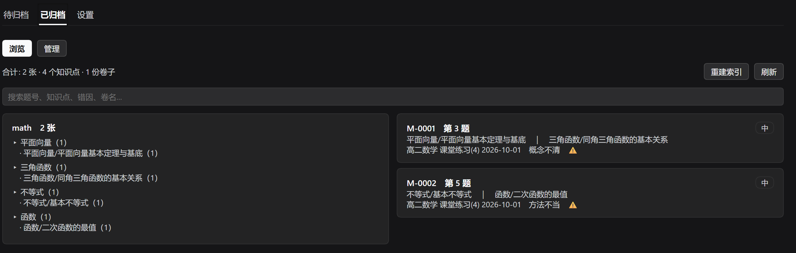
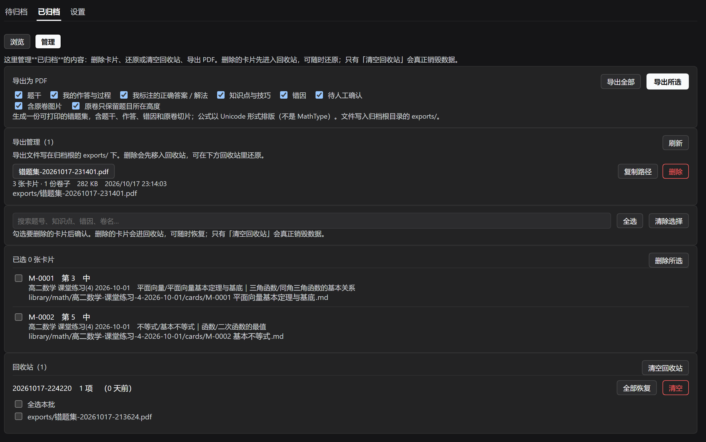
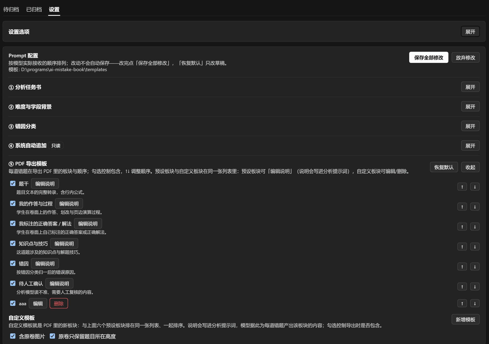
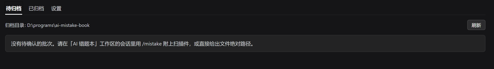

# AI 错题本 · DSH 插件

把**扫描试卷**变成一本**以知识点为索引的错题本**：投喂 PDF/图片 → 插件建批次并光栅化 → 模型在会话里读卷面、提取错题 → 生成卡片草稿 → **你确认后**归档进 `library/`，并自动重建索引。

不是"AI 帮你解题"，而是"AI 帮你把卷面上**已经存在**的东西整理成可复习的结构"。

## 功能

- **扫描件直读**：PDF 自动光栅化（默认 400 dpi），切成整页概览 + 高清横带；看不清时按需索取原生分辨率重切
- **只在错题上花力气**：按你报的题号逐题提取，题干、作答、划改、页边演算、卷面标注、知识点、错因、难度
- **绝不编造**：读不准的内容写进"待人工确认"，交给人核对
- **卡片即 Markdown**：`library/<学科>/<卷子>/cards/*.md`，带 front-matter，可手改、可 diff、可进版本库
- **知识点索引**：自动重建 `index.md` / `index.json`，按 学科 → 一级 → 二级知识点 归类
- **导出打印版 PDF**：板块（含自定义板块）可勾选、可排序；**公式以 Word 原生公式（OMML）排版**，不是 Unicode 拼凑
- **回收站**：删除先进 `_trash/`，可逐项还原，清空才真正销毁
- **会话可追溯**：待归档页可跳回分析会话继续修改
- **Prompt 配置**：设置页按模型实际接收顺序单列展示分析任务书、背景、错因分类和 PDF 导出模板；PDF 模板支持新增自定义板块，模型按板块说明为每道错题产出内容

> 更新记录见 [CHANGELOG.md](CHANGELOG.md)。

## 界面

| 已归档 · 浏览（按知识点索引） | 已归档 · 管理（导出 / 删除 / 回收站） |
|---|---|
|  |  |

| 设置 · Prompt 配置与 PDF 模板 | 待归档（空状态） |
|---|---|
|  |  |

- 「已归档 · 浏览」左栏是学科 → 一级知识点 → 二级知识点的索引树，右栏是卡片列表；点卡片可对照原卷裁剪图查看转录。
- 「已归档 · 管理」里导出 PDF、管理导出文件、删除卡片（进回收站）与还原。
- 「设置」里左侧是可收起的 Prompt 配置；PDF 模板是统一列表（预设板块 + 自定义板块），可拖动顺序、勾选包含、编辑说明，列表下方可新增自定义板块。

## 环境要求

- **DSH（DeepSeek Harness）桌面版**，Web/桌面 profile 均可。要求 DSH `>= 0.2.1-rc.2`
- 分析模型需要**支持图片输入**（插件启动前会校验，不支持会直接报错而不是静默失败）
- Node.js ≥ 22（DSH 自带运行时已满足）

## 安装

> 目前只通过 GitHub 分发（npm 包尚未发布）。

### 方式一：从 GitHub 安装（推荐）

```bash
dsh plugin --profile desktop add github:suanmingxing/dsh-ai-mistake-book
```

> 把 `desktop` 换成你实际使用的 profile（桌面版通常是 `desktop`，`dsh web` 用 `web`）。
> 装完**重启 DeepSeek Harness** 生效。

### 方式二：本地目录（开发/调试）

```bash
git clone https://github.com/suanmingxing/dsh-ai-mistake-book.git D:\tools\dsh-ai-mistake-book
dsh plugin --profile desktop add "link:D:/tools/dsh-ai-mistake-book"
```

> `link:` 安装时 pnpm 不会替插件装 `dependencies`，所以本仓库**已把必要依赖放在 `node_modules/` 里一并提交**（见 [VENDOR.md](VENDOR.md)）。若你删掉了它，请手动补装：`npm i @deepseek-ai/schemastery @deepseek-ai/cosmokit katex`。

## 首次使用

1. **设置归档根**：设置 → 插件 → AI 错题本 → `archiveRoot`，填一个你希望存放错题本的绝对路径（默认 `~/.dsh/ai-mistake-book`）。改这个字段需要重启插件。
2. **建一个"归档工作区"会话**：在 DSH 里打开该目录作为工作区（首次 `/mistake` 会自动创建）。
3. **投喂试卷**：
   ```
   /mistake 错题为 3、5、6、8、9、11 题  @"C:\path\to\扫描卷.pdf"
   ```
   或在插件页用模型工具 `mistake_ingest` 指定文件路径。
4. **等分析**：分析在当前会话里进行；期间该会话的工具会被临时收窄到 4 个（读页面、提交候选、提交决定、问用户确认），结束后自动恢复。
5. **确认归档**：插件页 →「待归档」核对候选 → 确认归档；之后到「已归档 → 管理」导出 PDF 或删除。正式归档需在插件页确认。
6. **定制版式与提词**（可选）：到「设置 → AI 错题本」的 Prompt 配置里改分析任务书、背景、错因分类；在 ⑤ PDF 导出模板里调整板块顺序、勾选或新增自定义板块。改完点「保存全部修改」，分析新试卷时生效。

## 数据与隐私

- **所有数据都在你自己的机器上**：试卷、转录、卡片、导出件都在 `archiveRoot` 下，插件不向任何第三方服务上传内容
- 模型调用走你 DSH 里配置的 provider（同样的调用链路，不会额外外发）
- 归档根结构：

```
<archiveRoot>/
├─ inbox/<batchId>/     进行中的批次（原始扫描、光栅图）
├─ library/<学科>/<卷子>/cards/*.md   归档后的错题卡片
├─ templates/           可编辑的提示词（analysis / background / error-taxonomy / custom-templates.json）
├─ exports/             导出的 PDF
├─ export-settings.json PDF 导出模板（板块顺序/勾选/预设说明/原卷图）
├─ _trash/              回收站
└─ index.md / index.json  自动生成的索引
```

## 主要设置项

| 设置 | 默认 | 说明 |
|---|---|---|
| `archiveRoot` | `~/.dsh/ai-mistake-book` | 错题本存放位置 |
| `pdfDpi` / `overviewDpi` | 400 / 200 | 横带与整页概览的分辨率 |
| `pagesPerRequest` | 2 | 一次投喂几页（每页 1 概览 + N 横带） |
| `maxRecutsPerPage` | 4 | 每页原生重切配额 |
| `restrictAnalysisTools` | true | 分析期间收窄会话工具集 |
| `analysisProvider` / `analysisModel` | 空 | 空 = 用部署默认；必须支持图片 |
| `deleteToTrash` | true | 删除进回收站而非销毁 |

## 设置页：设置选项与 Prompt 配置

设置页只有两块：

- **设置选项**（置顶，只读）：当前生效的模型、光栅化、导出与存储参数；真正的修改入口在 DSH 的「设置 → 插件 → AI 错题本」。
- **Prompt 配置**（单列，按模型实际接收顺序，所有板块都可收起/展开）：

  1. **分析任务书**（`templates/analysis.md`）——主体；`{{background}}` / `{{taxonomy}}` / `{{custom}}` 是插入点
  2. **难度与学段背景**（`templates/background.md`）——替换进分析任务书「三、难度标定背景」
  3. **错因分类**（`templates/error-taxonomy.md`）——替换进「四、错因分类」
  4. **系统自动追加**（只读折叠）——每批次固定追加的工具调用速记，不可编辑
  5. **PDF 导出模板**——**统一列表**：六个预设板块 + 你自己的自定义板块（`tpl:<id>`）混排，全部可勾选、↑↓ 排序；列表最下方可「新增模板」。
     - 每条板块（预设和自定义）都有自己的「说明」；预设板块点行内「编辑说明」可改（标题固定，说明可改），自定义板块可改标题+说明。**说明会写进分析提示词**，模型据此为每道错题产出板块内容；卡片里生成 `## 板块标题` 段落，导出 PDF 时按模板顺序显示。
     - 删除/停用自定义板块后，导出会跳过它；停用的板块不会被当成"未登记标题"重新塞回 PDF 末尾。
  6. 旧版本的 `templates/custom.json` 会在首次加载时自动并入分析任务书、原文件改名为 `custom.json.migrated`；新的自定义板块存在 `templates/custom-templates.json`（`{id,title,description,enabled}`，顺序和预设说明记在 `export-settings.json` 的 `order` / `descriptions` 里）。

不会自动保存：改完点「保存全部修改」；每块的「恢复默认」只改草稿，仍需保存。PDF 导出时「管理」页还可以对这一次导出做临时覆盖。

## 依赖说明

本插件在 `node_modules/` 里**随包提交**了三份依赖（合计约 0.7 MB）：`@deepseek-ai/schemastery`、`@deepseek-ai/cosmokit`（DSH 发布版，公开 npm 同版本）、`katex`。原因与升级方式见 [VENDOR.md](VENDOR.md)。

`katex` 仅用于会话内的公式预览（MathML），缺失时会降级为纯文本，不影响归档。

## 已知限制

- 公式排版覆盖错题卡常见写法（分数、根式、上下标、向量、`\left…\right`、希腊字母与常用运算符）；矩阵、分段函数等结构暂不支持，会退化为可读文本
- 分析依赖模型的视觉能力；看不清的字段会进入"待人工确认"，不会猜测
- 界面文案提供中/英两份字典，提示词模板本身默认中文

## 许可证

[MIT](LICENSE) © 2026 suanmingxing
